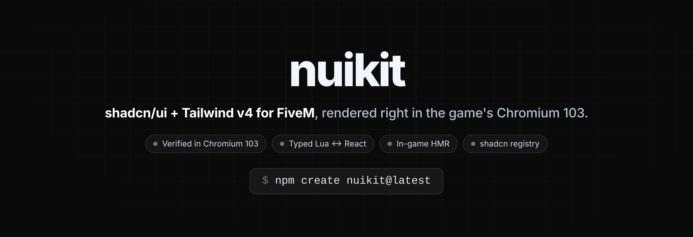
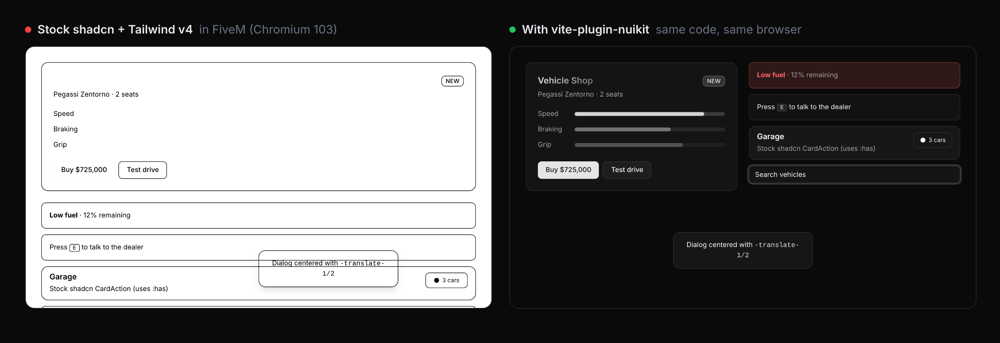
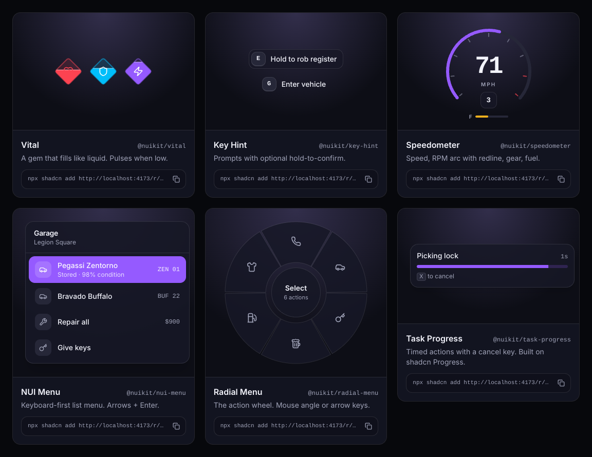
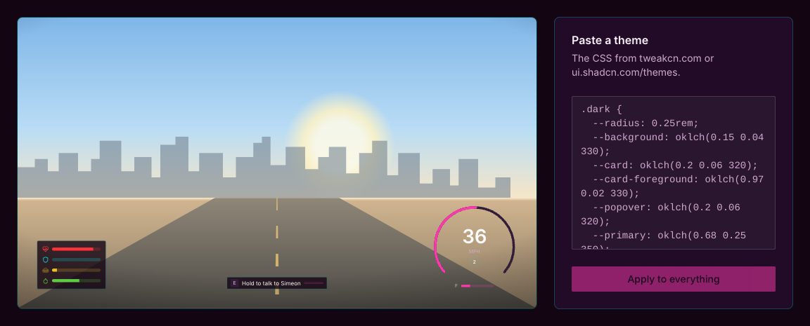

<div align="center">



<h3>shadcn/ui and Tailwind v4 for FiveM NUI, rendered right.</h3>

FiveM's NUI runs **Chromium 103**, and Tailwind v4 needs **111**. nuikit compiles your CSS down at build time.<br/>
It also gives you typed Lua ↔ React messaging, browser devtools that fake the game, hot reload in game, and a registry of HUD components.

[](https://github.com/belibathan/nuikit/actions/workflows/ci.yml)
[](https://www.npmjs.com/package/vite-plugin-nuikit)
[](examples/cef-proof)
[](LICENSE)
[](https://github.com/belibathan/nuikit)

**[Website & live demo](https://nuikit.vercel.app)** · [Quick start](#quick-start) · [Why](#why) · [Components](#components) · [API](#api)

</div>

<br/>

```bash
npm create nuikit@latest my-hud
```



<sub>Same code, same browser. Left: stock shadcn + Tailwind v4 in Chromium 103. Right: built with <code>vite-plugin-nuikit</code>. Rendered by <a href="examples/cef-proof">our CI</a> in a real Chromium 103 on every push.</sub>

## Why

Every modern shadcn theme is written in `oklch()`, and Tailwind v4 compiles to modern CSS. FiveM's in-game browser is Chromium 103, which drops all of it **silently**. You get buttons with no background, translucent panels that turn solid, dead breakpoints, and dialogs that aren't centered. Most FiveM UI kits handle this by staying on Tailwind v3. ([citizenfx/fivem#3312](https://github.com/citizenfx/fivem/issues/3312) is the open issue.)

| What you write | What Tailwind v4 emits | Chromium 103 | nuikit |
|---|---|---|---|
| any shadcn theme | `oklch(0.62 0.24 295)` | ✗ ignored (111+) | → `#955aff` |
| `bg-primary/50` | `color-mix(in oklab, var(--primary) 50%, transparent)` | ✗ ignored (111+) | → `rgba(var(--primary-rgb), …)`, **themes stay live** |
| `md:grid-cols-2` | `@media (width >= 48rem)` | ✗ ignored (104+) | → `(min-width: 48rem)` |
| `-translate-x-1/2` | `translate: …` | ✗ ignored (104+) | → `transform: translate(…)` |
| `bg-linear-to-r` | `linear-gradient(to right in oklab, …)` | ✗ ignored (111+) | → `to right` |
| `has-[>svg]:px-3`, `CardAction` | `:has(…)` | ✗ ignored (105+) | ⚠ reported; opt-in polyfill (`hasPolyfill: true`) for static menus |
| `@container`, `light-dark()` | as-is | ✗ (105+/123+) | ⚠ reported at build time |

The tricky one is `bg-primary/50`: it's a variable, so no build tool can precompute it. nuikit gives every color token RGB channels (`--primary-rgb`, `--primary-a`) and rewrites the opacity math to use them. **Changing the theme at runtime still works**, including in game.

## Quick start

```bash
npm create nuikit@latest my-hud      # or: pnpm create nuikit my-hud
cd my-hud/web && npm run dev
```

You get a complete FiveM resource:

```
my-hud/
├─ fxmanifest.lua
├─ client/
│  ├─ main.lua        ← your Lua: NUI.send / NUI.on / NUI.open
│  └─ nuikit.lua      ← the runtime (framework-agnostic)
└─ web/               ← Vite + React 19 + Tailwind v4 + shadcn
   └─ src/
      ├─ App.tsx
      ├─ nui.d.ts     ← the typed contract between Lua and React
      └─ dev.tsx      ← fake game data for the browser
```

- **In the browser:** `npm run dev`, then press <kbd>`</kbd> for the devtools. You can fire Lua events, mock callbacks, watch traffic and swap day/night backdrops.
- **In game:** drop the folder into `resources/`, `ensure my-hud`. While `dev` runs, `ui_page` points at Vite, so **every save hot-reloads in game**.
- **Ship:** `npm run build`. `ui_page` is restored automatically.

Already have a NUI? Use only the parts you want ([plugin](#nuikitvite), [runtime](#nuikitcore), [components](#components)).

## What's inside

| Package | What it does |
|---|---|
| [`vite-plugin-nuikit`](packages/vite) | Vite plugin. Lowers Tailwind v4 / shadcn CSS for Chromium 103, in-game HMR, `nuikit-doctor` CLI. |
| [`nuikit-core`](packages/core) | 4 KB runtime. Typed `fetchNui` / `useNuiEvent`, visibility & focus, devtools, runtime theming. Plus `nuikit.lua`. |
| [`create-nuikit`](packages/create-nuikit) | One command to a working resource. |
| [Registry](#components) | HUD components for the shadcn CLI, composed from stock shadcn (Card, Item, Kbd, Progress, Badge). |

### `vite-plugin-nuikit`

```ts
// vite.config.ts
import tailwindcss from "@tailwindcss/vite";
import react from "@vitejs/plugin-react";
import { nuikit } from "vite-plugin-nuikit";

export default defineConfig({
  plugins: [react(), tailwindcss(), nuikit()], // after tailwindcss()
});
```

Every build prints what it did:

```
◆ nuikit CEF compat · assets/index.css
  ✓ 24 color tokens with live channels
  ✓ 22 opacity modifiers rewritten (bg-primary/50 …)
  ✓ 3 translate/scale/rotate → transform
  ✓ nothing left that Chromium 103 can't render
```

Not using Vite? Check or fix any built UI:

```bash
npx nuikit-doctor web/dist          # report what won't render in game
npx nuikit-doctor web/dist --fix    # lower it in place
```

## API

One `nui.d.ts` types both directions:

```ts
// web/src/nui.d.ts
declare module "nuikit-core" {
  interface NuiEvents {    // Lua → UI
    "hud:vitals": { health: number; armor: number };
  }
  interface NuiCallbacks { // UI → Lua
    "shop:buy": { req: { id: string }; res: { ok: boolean; cash: number } };
  }
}
```

<table>
<tr><th>React</th><th>Lua</th></tr>
<tr><td>

```tsx
import { fetchNui, useNuiState, useNuiVisibility } from "nuikit-core/react";

const vitals = useNuiState("hud:vitals", { health: 100, armor: 0 });
const { visible, close } = useNuiVisibility(); // Esc closes

const { ok, cash } = await fetchNui("shop:buy", { id: "zentorno" });
//      ^ typed; wrong payload = compile error
```

</td><td>

```lua
RegisterCommand('shop', function() NUI.open() end)

NUI.on('shop:buy', function(data)
  local ok = BuyVehicle(data.id)
  return { ok = ok, cash = GetCash() } -- the response
end)  -- errors reach JS as NuiError

NUI.send('hud:vitals', { health = 80, armor = 50 })
NUI.notify({ title = 'Paid', type = 'success' })
```

</td></tr>
</table>

| `nuikit-core` | |
|---|---|
| `fetchNui(name, data?, { mock?, timeout? })` | Call a Lua callback. Resolves with its return value. Mocked in the browser. |
| `onNui(name, fn)` / `useNuiEvent(name, fn)` | Handle `NUI.send` messages. |
| `useNuiState(name, initial)` | Latest payload as state. |
| `useNuiVisibility()` | `{ visible, close }`, driven by `NUI.open/close`, Escape built in. |
| `useNuiCallback(name)` | `{ call, loading, error, data }`. |
| `mockNui(name, response)` / `emit(name, data)` | Fake Lua in the browser or tests. |
| `applyTheme(css \| vars)` | Apply a pasted TweakCN theme at runtime, with Chromium 103 channels. |
| `<NuiDevtools events callbacks />` | Browser-only panel (`nuikit-core/devtools`). Renders nothing in game. |

| `nuikit.lua` | |
|---|---|
| `NUI.send(action, data)` | Message the UI. |
| `NUI.on(name, fn)` | Handle `fetchNui`. The return value is the response; errors are caught. |
| `NUI.open({ focus?, cursor?, keepInput? })` / `NUI.close()` / `NUI.toggle()` | Visibility and focus in one call. Focus is released on resource stop. |
| `NUI.notify({ title, description?, type? })` | Toast via `<NuiToaster />`. |

## Components

Installed with the shadcn CLI you already use. They're **compositions of stock shadcn components**: the CLI pulls in the `card`, `item`, `kbd`, `progress` and `badge` they're built from. They follow shadcn's file conventions (`data-slot`, `React.ComponentProps`, `cva` variants) and use **only theme tokens**, so they follow your theme. Nothing here has its own visual language.

```bash
npx shadcn add https://nuikit.vercel.app/r/speedometer.json
# or, with the @nuikit registry in components.json (create-nuikit sets it up):
npx shadcn add @nuikit/speedometer
```



| Component | |
|---|---|
| `vital` | Player stat: icon + `Progress`, colored by a theme token. Pulses when low. |
| `speedometer` | SVG arc in `primary` / `destructive`; gear is a `Badge`, fuel a `Progress`. |
| `key-hint` | `[E] Talk`: `Kbd` + label, hold-to-confirm on `Progress`. |
| `nui-menu` | Keyboard-first list menu: a `Card` of `Item`s, highlighted with `accent` like shadcn menus. |
| `radial-menu` | The action wheel. SVG, because shadcn has no radial; styled like its menus (`popover`, `border`, `accent`). |
| `task-progress` | Timed actions: `Card` + `Progress` + `Kbd` cancel hint. |
| `nui-toaster` | Stock shadcn `sonner`, wired to `NUI.notify()`. |
| `use-nui-store` | Merge partial updates from Lua into one object. |

Anything else, use stock shadcn: `npx shadcn add dialog tabs select`. It'll render in game.

## Theming

nuikit has no theme system of its own. **shadcn's tokens are the system.** Paste any [TweakCN](https://tweakcn.com) or [shadcn theme](https://ui.shadcn.com/themes) into `web/src/index.css` and every component follows: yours, shadcn's and nuikit's.



To switch themes at runtime (per job, per player setting), use `applyTheme()`. It converts oklch to RGB in JS, because the game's browser can't.

```ts
import { applyTheme } from "nuikit-core";
applyTheme(`.dark { --primary: oklch(0.72 0.19 150); --radius: 0rem; }`);
```

## How it works

`vite-plugin-nuikit` runs after Tailwind on the final CSS:

1. **Lightning CSS → `chrome 103`:** oklch/lab to hex (with wide-gamut `@supports` blocks for newer browsers), flattened nesting, media range syntax.
2. **Token channels:** every color custom property gets `--x-rgb` / `--x-a`, alias chains included (`--color-primary: var(--primary)`).
3. **Opacity:** `color-mix(in oklab, var(--x) N%, transparent)` → `rgba(var(--x-rgb), calc(var(--x-a) * N))`, and the `@supports (color: color-mix(…))` guards are unwrapped so it applies on 103.
4. **Transforms:** `translate` / `scale` / `rotate` → one `transform`, composed from non-inheriting `@property` registrations. Keyframes are left alone.
5. **Gradients:** `in oklab` interpolation dropped; `dvh/svh` → `vh`.
6. **`:has()`:** shadcn uses it for small layout tweaks in Button, Card and Item, which degrade gracefully in game. `hasPolyfill: true` opts in to [css-has-pseudo](https://github.com/csstools/postcss-plugins/tree/main/plugins/css-has-pseudo); it's off by default because its runtime re-checks selectors on every DOM change, which a HUD updating 10 times a second can't afford.
7. **Audit:** anything that still can't be lowered (`@container`, `light-dark()`…) is reported, not silently shipped.

[`examples/cef-proof`](examples/cef-proof) compiles a real shadcn page and renders it before and after in **Chromium 103.0.5058** (via `@sparticuz/chromium@103`), asserting computed styles. It runs in CI.

## FAQ

<details><summary><b>Does it work with QBCore / Qbox / ESX / ox_lib?</b></summary>
Yes. nuikit has no framework dependency. Call your framework from your <code>NUI.on</code> handlers as usual.
</details>

<details><summary><b>RedM?</b></summary>
RedM uses the same CEF, so it should work. Change <code>game 'gta5'</code> to <code>game 'rdr3'</code>. Reports welcome.
</details>

<details><summary><b>Vue / Svelte / vanilla?</b></summary>
<code>vite-plugin-nuikit</code> and the core runtime (<code>nuikit</code>) are framework-agnostic. Only <code>/react</code>, <code>/devtools</code> and the registry components are React.
</details>

<details><summary><b>What happens when Cfx updates CEF?</b></summary>
<code>nuikit({ compat: 120 })</code> targets any Chromium version, and <code>compat: false</code> turns lowering off. The proof script warns when stock CSS starts rendering, so you'll know.
</details>

## Roadmap

- [ ] `nuikit types`: generate LuaLS annotations from `nui.d.ts`
- [ ] More components: phone shell, inventory grid, minimap frame, notifications stack, target eye
- [ ] Svelte and Vue templates

## Contributing

PRs welcome. See [CONTRIBUTING.md](CONTRIBUTING.md). `pnpm i && pnpm test && pnpm proof` runs everything, including the Chromium 103 render.

## License

[MIT](LICENSE). Not affiliated with Cfx.re, Rockstar Games, or shadcn.

<div align="center"><sub>If nuikit saved you a night of debugging CEF, a ⭐ helps other server devs find it.</sub></div>
