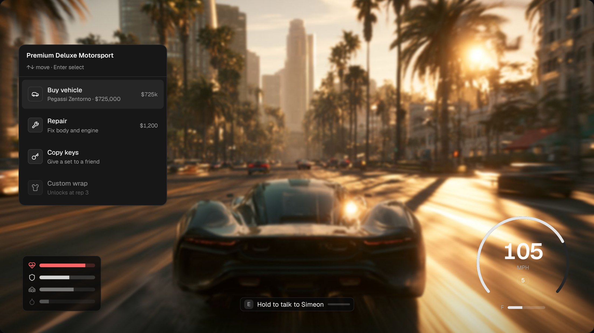
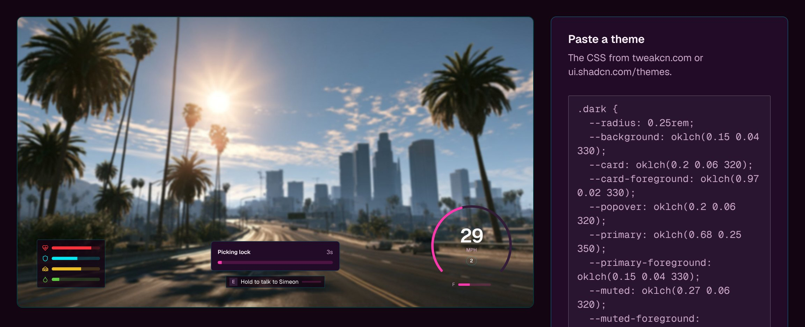

<div align="center">

<a href="https://nuikit.vercel.app"></a>

<br/>
<br/>

**One design system for your whole FiveM server.**<br/>
HUD, menus, inventory, pause, loading screen and more, rebuilt in stock shadcn/ui<br/>
and themed by one file. Drop in a folder, paste a TweakCN theme. Free and open source.

<br/>

[](https://www.npmjs.com/package/vite-plugin-nuikit)
[](https://www.npmjs.com/package/nuikit-core)
[](https://www.npmjs.com/package/create-nuikit)
<br/>
[](https://github.com/belibathan/nuikit/actions/workflows/ci.yml)
[](examples/cef-proof)
[](LICENSE)

**[Download nuikit.zip](https://github.com/belibathan/nuikit/releases/latest)** &nbsp;·&nbsp; [Website](https://nuikit.vercel.app) &nbsp;·&nbsp; [What it covers](docs/coverage.md) &nbsp;·&nbsp; [Quick start](#quick-start) &nbsp;·&nbsp; [Components](#components) &nbsp;·&nbsp; [API](#api) &nbsp;·&nbsp; [Theming](#theming) &nbsp;·&nbsp; [How it works](#how-it-works)

</div>

<br/>

**For servers:** download [`nuikit.zip`](https://github.com/belibathan/nuikit/releases/latest), put `[nuikit]` in `resources/`, copy the `overrides/` over the scripts you run, paste a theme. The zip's README walks through it. Works on Qbox and any server running ox_lib.

**For developers:** build your own resource on the same standard ([kit language](docs/design.md), components, theme):

```bash
npm create nuikit@latest my-hud
```

<a href="https://nuikit.vercel.app"></a>

<p align="center"><sub>The <a href="https://nuikit.vercel.app">live demo</a>: every panel is stock shadcn (Card, Item, Progress, Kbd, Badge), driven by typed <code>NUI.send</code> events.</sub></p>

<table>
<tr>
<td width="50%" valign="top">

**Stock shadcn, in game**<br/>
oklch themes, `bg-primary/50`, breakpoints, transforms and gradients lowered for Chromium 103. Themes stay live.

</td>
<td width="50%" valign="top">

**Typed Lua ↔ React**<br/>
One `nui.d.ts` types `NUI.send`, `fetchNui` and `NUI.on`. A wrong payload is a compile error.

</td>
</tr>
<tr>
<td valign="top">

**Devtools that fake the game**<br/>
Press <kbd>`</kbd> in the browser to fire Lua events, mock callbacks and watch traffic. No client restarts.

</td>
<td valign="top">

**Hot reload in game**<br/>
While `dev` runs, `ui_page` points at Vite. Every save updates the HUD in your running client.

</td>
</tr>
</table>

## Why

Every modern shadcn theme is written in `oklch()`, and Tailwind v4 compiles to modern CSS. FiveM's in-game browser is Chromium 103, which drops all of it **silently**. You get buttons with no background, translucent panels that turn solid, dead breakpoints, and dialogs that aren't centered. Most FiveM UI kits handle this by staying on Tailwind v3. ([citizenfx/fivem#3312](https://github.com/citizenfx/fivem/issues/3312) is the open issue.)

| What you write | What Tailwind v4 emits | Chromium 103 | nuikit |
|---|---|---|---|
| any shadcn theme | `oklch(0.62 0.24 295)` | ✗ ignored (111+) | → `#955aff` |
| `bg-primary/50` | `color-mix(in oklab, var(--primary) 50%, transparent)` | ✗ ignored (111+) | → `rgba(var(--primary-rgb), …)`, **themes stay live** |
| `md:grid-cols-2` | `@media (width >= 48rem)` | ✗ ignored (104+) | → `(min-width: 48rem)` |
| `-translate-x-1/2` | `translate: …` | ✗ ignored (104+) | → `transform: translate(…)` |
| `bg-linear-to-r` | `linear-gradient(to right in oklab, …)` | ✗ ignored (111+) | → `to right` |
| `has-[>svg]:px-3`, `CardAction` | `:has(…)` | ✗ ignored (105+) | ⚠ reported; opt-in polyfill (`hasPolyfill: true`) for static menus |
| `@container`, `light-dark()` | as-is | ✗ (105+/123+) | ⚠ reported at build time |

The tricky one is `bg-primary/50`: it's a variable, so no build tool can precompute it. nuikit gives every color token RGB channels (`--primary-rgb`, `--primary-a`) and rewrites the opacity math to use them. **Changing the theme at runtime still works**, including in game.

## Quick start

```bash
npm create nuikit@latest my-hud      # or: pnpm create nuikit my-hud
cd my-hud/web && npm run dev
```

You get a complete FiveM resource:

```
my-hud/
├─ fxmanifest.lua     ← imports the runtime: shared_script '@nuikit/init.lua'
├─ client/
│  └─ main.lua        ← your Lua: surfaces, nk.send / nk.on
└─ web/               ← Vite + React 19 + Tailwind v4 + shadcn
   └─ src/
      ├─ App.tsx
      ├─ nui.d.ts     ← the typed contract between Lua and React
      └─ dev.tsx      ← fake game data for the browser
```

- **In the browser:** `npm run dev`, then press <kbd>`</kbd> for the devtools. You can fire Lua events, mock callbacks, open surfaces, toggle states, watch traffic and swap day/night backdrops.
- **In game:** with the `nuikit` resource installed (it ships the Lua runtime your resource imports, like ox_lib), drop the folder into `resources/`, `ensure my-hud`. While `dev` runs, `ui_page` points at Vite, so **every save hot-reloads in game**.
- **Ship:** `npm run build`. `ui_page` is restored automatically.

Already have a NUI? Use only the parts you want ([plugin](#vite-plugin-nuikit), [runtime](#api), [components](#components)).

## What's inside

| Package | What it does |
|---|---|
| [`vite-plugin-nuikit`](packages/vite) | Vite plugin. Lowers Tailwind v4 / shadcn CSS for Chromium 103, in-game HMR, `nuikit-doctor` CLI. |
| [`nuikit-core`](packages/core) | The runtime. Typed `fetchNui` / `useNuiEvent`, [surfaces](#surfaces) (focus, layers, Escape across resources), devtools, runtime theming. Plus the Lua runtime, which resources import with `shared_script '@nuikit/init.lua'`. |
| [`create-nuikit`](packages/create-nuikit) | One command to a working resource. |
| [Registry](#components) | HUD components for the shadcn CLI, composed from stock shadcn (Card, Item, Kbd, Progress, Badge). |

### `vite-plugin-nuikit`

```ts
// vite.config.ts
import tailwindcss from "@tailwindcss/vite";
import react from "@vitejs/plugin-react";
import { nuikit } from "vite-plugin-nuikit";

export default defineConfig({
  plugins: [react(), tailwindcss(), nuikit()], // after tailwindcss()
});
```

Every build prints what it did:

```
◆ nuikit CEF compat · assets/index.css
  ✓ 24 color tokens with live channels
  ✓ 22 opacity modifiers rewritten (bg-primary/50 …)
  ✓ 3 translate/scale/rotate → transform
  ✓ nothing left that Chromium 103 can't render
```

Not using Vite? Check or fix any built UI:

```bash
npx nuikit-doctor web/dist          # report what won't render in game
npx nuikit-doctor web/dist --fix    # lower it in place
```

## API

One `nui.d.ts` types both directions:

```ts
// web/src/nui.d.ts
declare module "nuikit-core" {
  interface NuiEvents {    // Lua → UI
    "hud:vitals": { health: number; armor: number };
  }
  interface NuiCallbacks { // UI → Lua
    "shop:buy": { req: { id: string }; res: { ok: boolean; cash: number } };
  }
}
```

<table>
<tr><th>React</th><th>Lua</th></tr>
<tr><td>

```tsx
import { fetchNui, useNuiState, useNuiVisibility } from "nuikit-core/react";

const vitals = useNuiState("hud:vitals", { health: 100, armor: 0 });
const { visible, close } = useNuiVisibility(); // Esc closes

const { ok, cash } = await fetchNui("shop:buy", { id: "zentorno" });
//      ^ typed; wrong payload = compile error
```

</td><td>

```lua
RegisterCommand('shop', function() NUI.open() end)

NUI.on('shop:buy', function(data)
  local ok = BuyVehicle(data.id)
  return { ok = ok, cash = GetCash() } -- the response
end)  -- errors reach JS as NuiError

NUI.send('hud:vitals', { health = 80, armor = 50 })
NUI.notify({ title = 'Paid', type = 'success' })
```

</td></tr>
</table>

| `nuikit-core` | |
|---|---|
| `fetchNui(name, data?, { mock?, timeout? })` | Call a Lua callback. Resolves with its return value. Mocked in the browser. |
| `onNui(name, fn)` / `useNuiEvent(name, fn)` | Handle `NUI.send` messages. |
| `useNuiState(name, initial)` | Latest payload as state. |
| `useSurface(name)` / `<Surface name …>` | A surface's `{ open, visible, focused, data }` and the component that renders it. |
| `openSurface(name, data?)` / `closeSurface(name)` | Open or close a surface declared in Lua. |
| `useNuiStates()` | Client-wide states from `NUI.state()`. |
| `usePlayer()` | The player from `bridge.lua`, one shape on Qbox, QBCore, ESX or standalone. |
| `useNuiVisibility()` | `{ visible, close }` for single-UI resources (`NUI.open/close`). |
| `useNuiCallback(name)` | `{ call, loading, error, data }`. |
| `mockNui(name, response)` / `emit(name, data)` | Fake Lua in the browser or tests. |
| `applyTheme(css \| vars)` | Apply a pasted TweakCN theme at runtime, with Chromium 103 channels. |
| `<NuiDevtools events callbacks surfaces states />` | Browser-only panel (`nuikit-core/devtools`): events, surfaces, states, log. Renders nothing in game. |

| Lua (`nk`, imported with `shared_script '@nuikit/init.lua'`; `NUI` is the same table) | |
|---|---|
| `NUI.send(action, data)` | Message the UI. |
| `NUI.on(name, fn)` | Handle `fetchNui`. The return value is the response; errors are caught. |
| `NUI.surface(name, opts)` → `:open(data)` `:close()` `:update(data)` `:toggle()` `:isOpen()` | Declare a surface; nuikit handles focus, stacking and Escape. |
| `NUI.state(name, value)` / `NUI.getState(name)` | Client-wide states shared by every nuikit resource. |
| `NUI.open({ focus?, cursor?, keepInput? })` / `NUI.close()` / `NUI.toggle()` | Single-UI mode: a `main` surface on the panel layer. Focus is released on resource stop. |
| `NUI.notify({ title, description?, type? })` | Toast via `<NuiToaster />`. |

## Surfaces

A server's UI is many pieces at once: a HUD, a target eye, an inventory, a phone, a confirm dialog. Each one usually calls `SetNuiFocus` on its own, so they fight over the cursor and Escape closes the wrong thing. With nuikit, every piece **declares what it is** and nuikit decides focus, cursor, stacking and Escape **across every resource that uses it**.

```lua
local hud     = NUI.surface('hud',       { layer = 'hud' })                    -- takes no input
local inv     = NUI.surface('inventory', { layer = 'panel', exclusive = true, hides = { 'hud' }, blockedBy = { 'dead' } })
local confirm = NUI.surface('confirm',   { layer = 'modal' })

hud:open()
inv:open({ items = GetItems() })    -- focus + cursor, HUD hidden
confirm:open({ amount = 500 })      -- on top: takes focus; Escape closes it, then the inventory
NUI.state('dead', true)             -- shared: blocked surfaces refuse to open
```

```tsx
<Surface name="inventory" layer="panel" hides={["hud"]}>
  {(data) => <InventoryGrid items={data.items} />}
</Surface>

const confirm = useSurface("confirm"); // { open, visible, focused, data, close }
```

| Rule | |
|---|---|
| **Layers** | `hud` < `world` < `panel` < `modal` < `system`. Later opens stack above earlier ones in the same layer. |
| **Focus** | The top-most open surface that takes input (`input`: `none`, `cursor`, `keyboard`, `full`) gets NUI focus, in whichever resource owns it. |
| **Escape** | Closes the top surface that takes input, one per press. `escape = 'back'` sends it to your UI instead; `'ignore'` keeps it open. |
| **exclusive** | Opening it closes other open surfaces on its layer, in any resource. |
| **hides** | Names or layers hidden (not closed) while it's open. |
| **blockedBy** | States from `NUI.state()` that stop it opening. |

Every resource that imports the runtime (`@nuikit/init.lua`) keeps the same copy of the client-wide stack, and a resource started mid-session catches up. Updating the `nuikit` resource updates every resource that imports it; to run without it, copy `lib/nuikit.lua` from the nuikit resource into yours as a client script. The manager runs under real Lua 5.4 in CI, with events delivered both synchronously and queued. `NUI.open()` / `NUI.close()` still work for a single UI.

## `[nuikit]` systems

The UI for a whole server, in one download: `nuikit.zip` holds a **`[nuikit]`** folder you drop into `resources/` (the way Qbox ships `[qbx]`) and an **`overrides/`** folder of new interfaces for resources you already run. Everything is built from stock shadcn components and themed by one file. nuikit owns how things look; your framework and scripts keep the data and the rules. [What's covered on a Qbox server →](docs/coverage.md)

**Systems** (`[nuikit]/`)

| Resource | What it does | Replaces |
|---|---|---|
| [`nuikit`](systems/nuikit) | `theme.css`: paste a TweakCN theme and every nuikit UI on the server follows. | — |
| [`nuikit_hud`](systems/nuikit_hud) | Health, armor, needs, stress, voice and radio, cash, bank, job; speedometer with fuel, gear and seatbelt. | `qbx_hud` |
| [`nuikit_stress`](systems/nuikit_stress) | Keeps stress gain and its effects when the HUD is replaced. | stress in `qbx_hud` |
| [`nuikit_pause`](systems/nuikit_pause) | Esc pause menu: Resume, Map, Settings, Key bindings, Help, Disconnect, player card, players online. | GTA's Esc menu |
| [`nuikit_death`](systems/nuikit_death) | Death and last-stand screen with the countdown and keys of your medical resource. | its drawn text |
| [`nuikit_loading`](systems/nuikit_loading) | Loading screen with real progress, tips, links and the server theme. | `loadscreen` |
| [`nuikit_chat`](systems/nuikit_chat) | Chat theme in your theme's colours. | `qbx_chat_theme` |

**Overrides** (`overrides/`: same Lua, new interface)

| Resource | Interface |
|---|---|
| [`ox_lib`](addons/ox_lib) | Notifications, context and list menus, radial, input and alert dialogs, progress, skill check, text UI. Themes every Qbox script that uses ox_lib: garages, mechanic, customs, vehicle shop, jobs, multicharacter… |
| [`ox_inventory`](addons/ox_inventory) | Inventory, trunks, stashes, shops, crafting, hotbar, tooltips, drag and drop. |
| [`ox_target`](addons/ox_target) | The target eye and its options. |
| [`illenium-appearance`](addons/illenium-appearance) | Character creator, clothing, barber, tattoo and surgeon shops. |
| [`Renewed-Banking`](addons/Renewed-Banking) | Bank and ATM: accounts, transactions, deposit, withdraw, transfer. |
| [`mm_radio`](addons/mm_radio) | Radio. |
| [`qbx_scoreboard`](addons/qbx_scoreboard) · [`qbx_idcard`](addons/qbx_idcard) · [`qbx_taxijob`](addons/qbx_taxijob) · [`qbx_vehiclesales`](addons/qbx_vehiclesales) | Scoreboard, ID cards, taxi meter, used-car sale contract. |

Each override is a clean-room implementation of that resource's UI protocol (specs in [`docs/`](docs)), with none of its code.

They run on **Qbox, QBCore, ESX or standalone**: `bridge.lua` turns each framework's player data into one shape (`usePlayer()` in React), so a system is written once.

```lua
-- any nuikit resource
NUI.player.get()          -- { loaded, name, health, armor, hunger, thirst, stress, cash, bank, job, voice, ... }
NUI.player.onChange(fn)
```

```tsx
const { health, cash, job, voice } = usePlayer();
```

## Use the standard in your own resource

Everything in `[nuikit]` is built from three things you can use too, so a resource you write (or buy) looks like
the rest of the server without anyone designing it:

1. **The kit.** `nk-*` utilities for panels, rows, labels, numbers, HUD chips and screen anchors, in every
   `index.css` that `npm create nuikit` writes. The rules are on [nuikit.vercel.app/design](https://nuikit.vercel.app/design).
2. **The components.** `panel`, `menu-row`, `stat`, `meter`, `hud-chip` and the rest, from the registry below.
   See every state on [nuikit.vercel.app/components](https://nuikit.vercel.app/components).
3. **The theme.** Read colours only from shadcn tokens. The server's `nuikit/theme.css` (any TweakCN theme)
   then recolours your UI along with the pause menu, HUD and overrides.

```bash
npm create nuikit@latest my-resource          # starts on the kit, with a HUD, a menu and a confirm
npx shadcn add https://nuikit.vercel.app/r/panel.json https://nuikit.vercel.app/r/menu-row.json
```

Whole screens (a HUD, a shop, a garage, a bank…) are coming as blocks you can install the same way.

## Components

Installed with the shadcn CLI you already use. They're **compositions of stock shadcn components**: the CLI pulls in the `card`, `item`, `kbd`, `progress` and `badge` they're built from. They follow shadcn's file conventions (`data-slot`, `React.ComponentProps`, `cva` variants) and use **only theme tokens**, so they follow your theme. Nothing here has its own visual language.

```bash
npx shadcn add https://nuikit.vercel.app/r/speedometer.json
# or, with the @nuikit registry in components.json (create-nuikit sets it up):
npx shadcn add @nuikit/speedometer
```


| Component | |
|---|---|
| `panel` | The one floating surface: header (title, description, actions, optional tabs row), scrolling body, footer. |
| `menu-row` | 40px action row: icon, label, description, trailing meta / chevron / `Kbd` / checkbox / stepper. |
| `stat` | Label over a tabular number that matters, in three sizes, with meta and a delta. On a panel or the game. |
| `meter` | Slim bar on a theme or game track, with low/high thresholds and segments. |
| `hud-chip` | Always-on pill or tile on the game: icon and text, active or warning. |
| `vital` | Player stat: icon + `Progress`, colored by a theme token. Pulses when low. |
| `speedometer` | SVG arc in `primary` / `destructive`; gear is a `Badge`, fuel a `Progress`. |
| `key-hint` | `[E] Talk`: `Kbd` + label, hold-to-confirm on `Progress`. |
| `nui-menu` | Keyboard-first list menu: a `Card` of `Item`s, highlighted with `accent` like shadcn menus. |
| `radial-menu` | The action wheel. SVG, because shadcn has no radial; styled like its menus (`popover`, `border`, `accent`). |
| `task-progress` | Timed actions: `Card` + `Progress` + `Kbd` cancel hint. |
| `nui-toaster` | Stock shadcn `sonner`, wired to `NUI.notify()`. |
| `use-nui-store` | Merge partial updates from Lua into one object. |

Anything else, use stock shadcn: `npx shadcn add dialog tabs select`. It'll render in game.

## Theming

nuikit has no theme system of its own. **shadcn's tokens are the system.** Paste any [TweakCN](https://tweakcn.com) or [shadcn theme](https://ui.shadcn.com/themes) into `web/src/index.css` and every component follows: yours, shadcn's and nuikit's.



To switch themes at runtime (per job, per player setting), use `applyTheme()`. It converts oklch to RGB in JS, because the game's browser can't.

```ts
import { applyTheme } from "nuikit-core";
applyTheme(`.dark { --primary: oklch(0.72 0.19 150); --radius: 0rem; }`);
```

## How it works

`vite-plugin-nuikit` runs after Tailwind on the final CSS:

1. **Lightning CSS → `chrome 103`:** oklch/lab to hex (with wide-gamut `@supports` blocks for newer browsers), flattened nesting, media range syntax.
2. **Token channels:** every color custom property gets `--x-rgb` / `--x-a`, alias chains included (`--color-primary: var(--primary)`).
3. **Opacity:** `color-mix(in oklab, var(--x) N%, transparent)` → `rgba(var(--x-rgb), calc(var(--x-a) * N))`, and the `@supports (color: color-mix(…))` guards are unwrapped so it applies on 103.
4. **Transforms:** `translate` / `scale` / `rotate` → one `transform`, composed from non-inheriting `@property` registrations. Keyframes are left alone.
5. **Gradients:** `in oklab` interpolation dropped; `dvh/svh` → `vh`.
6. **`:has()`:** shadcn uses it for small layout tweaks in Button, Card and Item, which degrade gracefully in game. `hasPolyfill: true` opts in to [css-has-pseudo](https://github.com/csstools/postcss-plugins/tree/main/plugins/css-has-pseudo); it's off by default because its runtime re-checks selectors on every DOM change, which a HUD updating 10 times a second can't afford.
7. **Audit:** anything that still can't be lowered (`@container`, `light-dark()`…) is reported, not silently shipped.

[`examples/cef-proof`](examples/cef-proof) compiles a real shadcn page and renders it before and after in **Chromium 103.0.5058** (via `@sparticuz/chromium@103`), asserting computed styles. It runs in CI.

## FAQ

<details><summary><b>Does it work with QBCore / Qbox / ESX / ox_lib?</b></summary>
Yes. nuikit has no framework dependency. Call your framework from your <code>NUI.on</code> handlers as usual.
</details>

<details><summary><b>RedM?</b></summary>
RedM uses the same CEF, so it should work. Change <code>game 'gta5'</code> to <code>game 'rdr3'</code>. Reports welcome.
</details>

<details><summary><b>Vue / Svelte / vanilla?</b></summary>
<code>vite-plugin-nuikit</code> and <code>nuikit-core</code> are framework-agnostic. Only <code>/react</code>, <code>/devtools</code> and the registry components are React.
</details>

<details><summary><b>What happens when Cfx updates CEF?</b></summary>
<code>nuikit({ compat: 120 })</code> targets any Chromium version, and <code>compat: false</code> turns lowering off. The proof script warns when stock CSS starts rendering, so you'll know.
</details>

## Roadmap

- [x] Surfaces: one owner for focus, layers and Escape across resources
- [x] `bridge.lua`: one player shape for Qbox, QBCore, ESX, standalone
- [x] Systems: HUD, stress, pause, death, loading screen, chat theme
- [x] Overrides: ox_lib, ox_inventory, ox_target, illenium-appearance, Renewed-Banking, mm_radio, scoreboard, ID card, taxi meter, vehicle sales
- [ ] Theme spec: the contract any script can follow to match the server theme
- [ ] Phone (npwd), minigames, police fingerprint, lap races
- [ ] `create-nuikit -t qbox`: zero to a themed local server in one command
- [ ] `nuikit types`: generate LuaLS annotations from `nui.d.ts`

## Contributing

PRs welcome. See [CONTRIBUTING.md](CONTRIBUTING.md). `pnpm i && pnpm test && pnpm proof` runs everything, including the Chromium 103 render.

## License

[MIT](LICENSE). Not affiliated with Cfx.re, Rockstar Games, or shadcn. Logos and artwork live in [`docs/brand`](docs/brand).

<br/>

<div align="center">
<a href="https://github.com/belibathan/nuikit"></a>
<br/>
<sub>Designed and built by <a href="https://github.com/belibathan"> <b>@belibathan</b></a></sub>
<br/>
<sub>If nuikit saved you a night of debugging CEF, a ⭐ helps other server devs find it.</sub>
</div>
