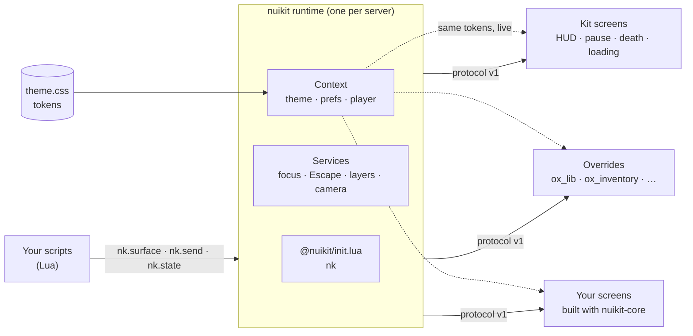

<div align="center">

<a href="https://nuikit.vercel.app"></a>

# nuikit

**The shared layer between scripts and screens on any FiveM server.**

Give your server a premium UI of its own without rewriting its scripts. Every screen, menu and override reads
one theme, so the whole server looks like one product, and focus and Escape just work across every resource.
Free and open source.

[](https://www.npmjs.com/package/nuikit-core)
[](https://www.npmjs.com/package/vite-plugin-nuikit)
[](https://www.npmjs.com/package/create-nuikit)
[](https://github.com/belibathan/nuikit/actions/workflows/ci.yml)
[](LICENSE)

**[Download nuikit.zip](https://github.com/belibathan/nuikit/releases/latest)** · [Website](https://nuikit.vercel.app) · [Components](https://nuikit.vercel.app/components) · [Blocks](https://nuikit.vercel.app/blocks) · [Theme studio](https://nuikit.vercel.app/theme)

</div>

<!-- TODO(hero): add one hero image here: the compact HUD or an identity contact sheet rendered over an
original backdrop (not a game screenshot), committed under docs/assets/ and kept under ~400 KB. The
existing sheets in bench/hud/shots and bench/identity/shots use game captures as backdrops, so they aren't used. -->

## What you get

**For servers**

- **Drop-in screens.** HUD, pause menu, death screen, loading screen and chat theme in one `[nuikit]` folder.
- **Overrides for scripts you already run.** New interfaces for ox_lib, ox_inventory, ox_target,
  illenium-appearance, Renewed-Banking and more. Their Lua stays untouched, and so do the scripts that call them.
- **One theme for everything.** Paste a TweakCN theme into `nuikit/theme.css` and every nuikit UI repaints live.
- **Four identities.** Graphite, Signal, Velvet and Vector: type, shape, surface, density and motion, not just colour.
- **A compact HUD.** A round radar with the compass on its ring, a speed cluster, and vitals shown when they change.

**For developers**

- **Import it like ox_lib.** `shared_script '@nuikit/init.lua'` gives your resource `nk`: surfaces, messaging,
  shared states, the player and preferences.
- **Components and blocks.** shadcn registry items built from stock shadcn/ui: `npx shadcn add` a component,
  or start from a whole screen.
- **`npm create nuikit`.** A working resource (Lua and web) with browser devtools that fake the game and hot
  reload in game.
- **`nuikit check`.** Audits a resource against the protocol and reports its conformance level (1 to 3).

## How it works



The `nuikit` resource is the runtime. Scripts import it with one line and get `nk`, so updating nuikit
updates every resource that uses it. The runtime owns what UIs must not fight over: which surface has focus,
what Escape closes, what sits above what, and (next) the camera and game controls. Screens talk to it through
a written, versioned [protocol](docs/protocol.md), so a bespoke screen joins the same stack as the kit's own.
The server compiles `theme.css` once into [tokens](docs/tokens.md) and sends them to every UI, overrides
included; `nuikit theme reload` repaints them all without a restart. The player comes through one bridge over
Qbox, QBCore, ESX or standalone, so a screen is written once.

Next, in 0.7: scripts ask for **intents** (notify, menu, input, progress…), swappable themed **renderers**
draw them, and **adapters** bring ox, QBCore and ESX scripts in without rewrites. Design:
[`docs/architecture.md`](docs/architecture.md).

## Quick start

**Install on a server.** Download the zip for your framework (`nuikit-qbox.zip`, `-qbcore`, `-esx`,
`-standalone`) from the [latest release](https://github.com/belibathan/nuikit/releases/latest), put `[nuikit]`
in `resources/` and add one line to `server.cfg`, after your framework:

```cfg
exec @nuikit/nuikit.cfg
```

`[nuikit]/nuikit/nuikit.cfg` starts everything in order and holds the settings; `server.cfg.snippet` in the zip
has the `stop` lines for your framework. New Qbox server: the txAdmin recipe in `install/recipe-qbox.yaml`.

For each folder in `overrides/`, back up the real resource, then copy ours over it (merge, don't replace).
The zip's README covers start order and what each screen replaces.

**Import in your resource.**

```lua
-- fxmanifest.lua
dependency 'nuikit'
shared_script '@nuikit/init.lua'
```

```lua
local shop = nk.surface('shop', { layer = 'panel', hides = { 'hud' } })
shop:open({ items = GetItems() })   -- focus, cursor and Escape handled across resources
nk.notify({ title = 'Paid', type = 'success' })
```

**Start a UI.**

```bash
npm create nuikit@latest my-ui -- -t garage
cd my-ui/web && npm run dev          # press ` for the devtools
```

Leave out `-t` for a demo, or pick any block below. See [`create-nuikit`](packages/create-nuikit).

## Make it yours

Tokens come in three tiers: **identity** (about 20 values a server sets: type, shape, surface, density,
motion, HUD style), **semantic** (shadcn's colours plus game ones like `hud` and `vital-*`), and **component**
(`--nk-panel-*`, `--nk-row-*`, …, derived from the other two, each one overridable). Components read only
component tokens, so changing a few identity values changes the whole server. Spec: [`docs/tokens.md`](docs/tokens.md).

| Identity | Character |
|---|---|
| **Graphite** (default) | Utilitarian: minimal, neat, compact. What a plain theme paste compiles to |
| **Signal** | Bold and street: condensed display type, chamfered corners, solid fills |
| **Velvet** | Soft and warm: rounded, gradient surfaces, roomy, smooth motion |
| **Vector** | Tactical instrument: mono numerals, hairlines, outlined rows, digital gauges |

1. Copy an identity from `nuikit/themes/` over `nuikit/theme.css`, or paste any [TweakCN](https://tweakcn.com)
   or shadcn theme. Missing values are derived; contrast problems print in the server console.
2. Run `nuikit theme reload` in the server console. Every open UI repaints.
3. Tune it in the [theme studio](https://nuikit.vercel.app/theme): paste, tweak, check contrast, download `theme.css`.

Players get their own accessibility preferences on top: `/nuikit scale 1.1`, `/nuikit motion off`,
`/nuikit contrast on`.

## What's included

**Systems** (`[nuikit]/`)

| Resource | What it does | Replaces |
|---|---|---|
| [`nuikit`](systems/nuikit) | The runtime: `@nuikit/init.lua`, theme compiler, `nuikit theme reload`, player prefs, identity themes and fonts | — |
| [`nuikit_hud`](systems/nuikit_hud) | Vitals, voice, money, job, ammo; vehicle cluster and flight instruments; radar with compass and location. `compact` or `classic` layout | `qbx_hud` |
| [`nuikit_stress`](systems/nuikit_stress) | Keeps stress gain and effects when the HUD is replaced | stress in `qbx_hud` |
| [`nuikit_pause`](systems/nuikit_pause) | Esc menu with a framing camera, 3D map, key bindings and player card | GTA's Esc menu |
| [`nuikit_death`](systems/nuikit_death) | Last stand and death with your medical resource's timers and keys | its drawn text |
| [`nuikit_loading`](systems/nuikit_loading) | Loading screen with real progress, tips, links and the server theme | `loadscreen` |
| [`nuikit_chat`](systems/nuikit_chat) | Chat theme in your server's tokens | `qbx_chat_theme` |

**Overrides** (`overrides/`: same Lua, new interface; clean-room from specs in [`docs/`](docs))

| Resource | Interface |
|---|---|
| [`ox_lib`](addons/ox_lib) | Notify, context and list menus, input, alert, progress bar and circle, skill check, text UI, radial |
| [`ox_inventory`](addons/ox_inventory) | Inventory, stashes, trunks, shops, crafting, hotbar, drag and drop |
| [`ox_target`](addons/ox_target) | The target eye and its options |
| [`illenium-appearance`](addons/illenium-appearance) | Character creator, clothing, barber, tattoo and surgeon shops |
| [`Renewed-Banking`](addons/Renewed-Banking) | Bank and ATM |
| [`mm_radio`](addons/mm_radio) | Radio and the "who's talking" overlay |
| [`qbx_scoreboard`](addons/qbx_scoreboard) · [`qbx_idcard`](addons/qbx_idcard) · [`qbx_taxijob`](addons/qbx_taxijob) · [`qbx_vehiclesales`](addons/qbx_vehiclesales) | Scoreboard, ID cards, taxi meter, sale contract |

**Components** (`npx shadcn add https://nuikit.vercel.app/r/<name>.json`, previews on [/components](https://nuikit.vercel.app/components))

| Group | Components |
|---|---|
| Surfaces and rows | `panel`, `menu-row`, `nui-menu`, `radial-menu`, `confirm`, `form-field`, `empty-state` |
| Numbers and levels | `stat`, `meter`, `progress-ring`, `countdown`, `money`, `vital`, `speedometer` |
| On the game | `hud-chip`, `notice`, `key-prompt`, `skill-check` |
| Things and people | `item-slot`, `player-card` |
| Hooks | `use-nui-store` |

Deprecated but still working: `key-hint` (use `key-prompt`), `task-progress` (use `meter` or `progress-ring`),
`nui-toaster` (use `notice`).

**Blocks** (`npm create nuikit my-ui -- -t <block>`, previews on [/blocks](https://nuikit.vercel.app/blocks))

| Block | What |
|---|---|
| `hud-minimal` | Vitals, needs, voice, money, job and a speedometer |
| `death-screen` | Last stand and death: countdown, call EMS, hold to respawn |
| `pause-menu` | Esc menu in place of GTA's |
| `loading-screen` | Real load progress, tips, links, backgrounds and music |
| `settings` | Player settings and nuikit's accessibility prefs |
| `scoreboard` | Who's online, a search, and which activities can start |
| `garage` | Your vehicles; take out, store, release from the impound |
| `bank` | Accounts, transactions; deposit, withdraw, transfer |
| `job-menu` | Duty toggle, job actions and staff management for bosses |
| `interaction` | A target eye and [E] key prompts |
| `shop` | Catalogue, cart and checkout |
| `inventory` | Pockets and a stash side by side, drag and drop, hotbar |
| `vehicle-shop` | A showroom with stats, paint, test drives and buying |
| `character-select` | Character slots, create, delete and spawn |

Blocks that move money or items check every action on the server.

## Status, honestly

- **Released: 0.6.0.** The kit, the theme engine, protocol v1, `nuikit check` and nine blocks, tested in game
  on Qbox through prereleases. Known issues are listed in the [roadmap](docs/roadmap.md).
- **Upcoming: 0.7.0.** The four identities, the compact HUD and five more blocks are merged for it. The
  identity fonts across resources, the HUD's second in-game round and its driving cost are still to be
  checked in game.
- **Not built yet.** Intents, renderers, the camera and controls services, the ox/QBCore/ESX adapter packs and
  `nuikit doctor` are the 0.7 plan, not features today.
- **Frameworks.** Tested in game on Qbox. The bridge supports QBCore, ESX and standalone; those haven't had
  an in-game round yet.
- **Chromium 103.** FiveM's in-game browser is Chromium 103 until Chromium 144 (on canary since October 2026)
  reaches the release channel. `vite-plugin-nuikit` lowers Tailwind v4 and shadcn CSS so it renders there;
  `:has()` and `@container` are reported, not relied on.
- **`nuikit check`** lives in [`packages/cli`](packages/cli) and isn't published to npm yet.

What's next and who's on it: [`docs/roadmap.md`](docs/roadmap.md).

## Docs

| Doc | What |
|---|---|
| [Vision](docs/vision.md) | Why nuikit exists and where it's going |
| [Architecture](docs/architecture.md) | Runtime, intents, adapters, renderers; the 0.7 plan |
| [Protocol](docs/protocol.md) | The standard (v1): surfaces, messaging, theme, context, conformance |
| [Tokens](docs/tokens.md) | Tokens v1.1, the compiler, identities, fonts, player prefs |
| [Design](docs/design.md) · [Design v2](docs/design/v2.md) | The kit language; identities and the flagship HUD |
| [Coverage](docs/coverage.md) | What's covered on a Qbox server |
| [Roadmap](docs/roadmap.md) | Status and what's next |
| [Contributing](CONTRIBUTING.md) · [Dispatch](docs/next/dispatch.md) | How to contribute; lanes for parallel work |

## Credit and licence

Designed and built by <a href="https://github.com/belibathan"> <b>@belibathan</b></a>.

[MIT](LICENSE). Not affiliated with Cfx.re, Rockstar Games or shadcn. Overrides are clean-room
implementations and contain none of the original resources' code. Logos live in [`docs/brand`](docs/brand).
