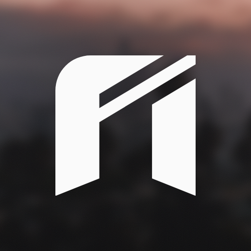

# nuikit brand

The mark is a lowercase **n** built like a doorway into the game: two legs on bevelled feet, cut by two bands at 31°. The bands borrow the slash of the shadcn mark; the cut feet and steep cut borrow FiveM's. It is drawn on a 100-unit grid.

## Files

| File | Use |
|---|---|
| [`mark.svg`](mark.svg) | Primary mark, `currentColor`. Use this in code. |
| [`mark-black.svg`](mark-black.svg) / [`mark-white.svg`](mark-white.svg) | Fixed-color marks for documents and light/dark backgrounds. |
| [`mark-small.svg`](mark-small.svg) | Single-band version for **24px and below** (favicons, tabs); the two bands merge at small sizes. Follows the system light/dark setting. |
| [`icon-dark.svg`](icon-dark.svg) / [`icon-light.svg`](icon-light.svg) | App icon: mark in a rounded square. |
| [`avatar.png`](avatar.png) | 512×512 avatar for GitHub, npm and social. |
| [`../assets/banner.png`](../assets/banner.png) | README banner and GitHub social preview (1280×640). |

| Primary | Small (≤24px) | Icon | Avatar |
|:-:|:-:|:-:|:-:|
|  |  |  |  |

## Lockup

Mark + **nuikit** set in [Geist](https://vercel.com/font) SemiBold, tracking −4.5%. The mark is 0.92× the type size, with a gap of 0.28× the type size.

## Color

nuikit has no brand color, on purpose. Like shadcn, it's neutral: `#0a0a0a` and `#fafafa`, with `#262626` and `#737373` for surfaces and secondary text. Product UI takes its color from whatever shadcn theme you paste.

## Imagery

Covers and site backdrops are Los Santos–style city scenes, always blurred (6px for game views, 18–22px behind text) and dimmed under type. Sources and export frames live in the Figma file.

## Don't

- Recolor the bands, add gradients, or outline the mark.
- Rotate it, mirror it, or change the 31° angle.
- Use the two-band mark below 24px. Use `mark-small.svg`.
- Put the mark on a busy, unblurred photo.
