# Components: the network

The registry (`registry/nuikit/ui`) is a network, not a list: a few **foundation** primitives, highly
configurable and driven by `--nk-*` levers, and every other component a **composite** that configures them
with props. **Blocks** (`registry/nuikit/blocks`) compose composites into whole screens. A theme restyles a
primitive once and every composite follows; a composite never draws its own bar, key, chip or gauge.

Primitive specs (anatomy, states, levers): the primitives spec (`docs/design/ink.md` §3) and the kit levers (1.5) in [tokens.md](../tokens.md).
Each component's doc comment carries the template (Role / Anatomy / Props / Level means / Rules), mirrored in its
`registry.json` `meta.spec`; `registry/nuikit/test/registry-meta.test.ts` keeps them in step, and
`registry/nuikit/test/composition.test.tsx` holds the composition contracts below.

## The graph

```mermaid
flowchart TB
  subgraph F["Foundation"]
    Tile["Tile / Kbd"]
    Fill
    Chip
    Text
    IconText
    Dial
    Stack["Stack / Cluster"]
    Panel["Panel (surface)"]
    ActionBar
    Run["useLinearRun (motion)"]
  end
  subgraph C["Composites"]
    Meter; ProgressRing; Countdown; Speedometer; Notice; KeyPrompt; SkillCheck
    EdgeSheet; DialogShell; SheetSection; Confirm; EmptyState; MenuRow
    Stat; Money; PlayerCard; Band; VitalChip; RadialMenu; ItemSlot; FormField
  end
  subgraph A["Deprecated aliases (removeIn 0.10.0)"]
    HudChip; Vital; NuiMenu
  end
  IconText --> Text
  Stat --> Text
  Money --> Text
  ActionBar --> Tile
  ActionBar --> Fill
  Meter --> Fill
  Meter --> Run
  ProgressRing --> Dial
  ProgressRing --> Tile
  ProgressRing --> Run
  Countdown --> Fill
  Countdown --> Run
  Notice --> Fill
  Notice --> Run
  Speedometer --> Dial
  Speedometer --> Tile
  Speedometer --> Fill
  KeyPrompt --> Tile
  KeyPrompt --> Fill
  SkillCheck --> Tile
  EdgeSheet --> ActionBar
  EdgeSheet --> Fill
  DialogShell --> ActionBar
  DialogShell --> Stack
  SheetSection --> Stack
  Confirm --> Panel
  EmptyState --> Tile
  MenuRow --> Tile
  MenuRow --> Meter
  PlayerCard --> Panel
  PlayerCard --> Chip
  PlayerCard --> Stat
  Band --> Fill
  Chip --> Fill
  Dial --> Fill
  HudChip -.-> Chip
  Vital -.-> Meter
  NuiMenu -.-> Panel
  NuiMenu -.-> MenuRow
```

(`Band`, `Chip` and `Dial` import only `toneVars()` from Fill: the one tone and hue vocabulary.)

## Foundation

| Primitive | File | What it is | Props (the configuration) | Levers |
|---|---|---|---|---|
| **Tile** (+ `Kbd`, `KbdGroup`) | `tile.tsx` | The keycap: keys, notice and empty-state icons, gears, checked boxes | `size` sm/md/lg, `shape` key/square, `state` rest/focus/hold/confirm/alert/disabled, `active`, `level`, `tone`, `hue`, `tag`, `tagOpen`, `plate`, `land` | `--nk-tile-*`, `--nk-h-key/chip/control`, `--nk-r-key`, scan role |
| **Fill** (+ `fillTargets`, `alertAt`, `toneVars`) | `fill.tsx` | The one level bar: holds, sweeps, meters, timers, edges | `level`, `tone`, `hue`, `alertAt`, `alert`, `variant` bar/edge, `tween` | `--nk-fill-color/track/edge/alert/height`, `--nk-time-fill` |
| **Chip** | `chip.tsx` | A short status on one line, in two materials | `material` panel/hud, `tone`, `hue`, `fill` hair/tint/solid, `icon`, `count`, `variant` chip/dot, `shape` pill/tile, `state`, `active`, `density`, `motion` | `--nk-h-chip`, `--nk-r-chip`, `--nk-chip-*` |
| **Text** | `text.tsx` | The type roles as one component, and the value ladder | `variant` scan/title/label/num/body/caption/display, `size` inherit/sm/md/display, `as` | `--nk-type-<role>-*`, `--nk-text-*`, `--nk-hud-value-size` |
| **IconText** | `icon-text.tsx` | An icon and a Text role on one centre line | `icon`, `text` label/num/body, `size`, `muted` | `--nk-gap-cluster`, `--nk-icon-*` |
| **Dial** | `dial.tsx` | One arc geometry: gauges and rings | `level`/`value`+`max`, `size`, `variant` ticks/digital, `ticks`, `segments`, `redline`, `alert`, `needle`, `tone`, `hue`, `surface` game/theme/none, `sweep` (240 gauge, 360 ring), `start`, `thickness`, `inset`, `trackProps`, `valueProps` | `--nk-gauge-*`, `--nk-fill-*` |
| **Stack / Cluster** | `stack.tsx` | Layout on the gap levers | `direction`, `gap` none/key/items/cluster/section/surface, `align`, `justify`, `wrap`, `as` | `--nk-gap-*`, `--nk-space-*`, `--nk-pad-surface` |
| **Panel** (surface) | `panel.tsx` | The floating surface (`nk-panel`); its header, body and footer | `size`, `selected`, `animate`, `density`, `shape`, `motion` | `--nk-panel-*`, the menu material |
| **ActionBar** | `action-bar.tsx` | The one hint, back and close pattern: Kbd Tiles, a label, a hold Fill | `plate`, `keys`, `icon`, `label`, `onClick`, `level`, `state` | `--nk-gap-items`, the plate recipe |
| **useLinearRun** (motion) | `hooks/use-linear-run.ts` | The one timed run: linear Web Animations on one start time (pseudo-elements too), a completion from a timer, elapsed, pause and resume, a motion gate | `duration`, `elapsed`, `paused`, `targets`, `onComplete`, `motion` always/respect, `release`, `deps` | `data-nk-motion`, reduced-motion |

Entrance and stagger motion is `nuikit-core/react` (`Stagger`, `useStaggerItem`) and `nuikit-core/motion`; the
kit's `nk-enter` / `nk-rise` classes. Those stay in core: they are runtime, not registry.

## Composites

| Component | Composes | What is still its own |
|---|---|---|
| Meter | Fill (segments, slab line), useLinearRun | The continuous bar stays shadcn Progress (design rule 10; identity CSS hooks: pips, stepped, segments overlay); thresholds, `meterColor()`, the label row, the cancel key |
| ProgressRing | Dial (sweep 360), Kbd Tile, useLinearRun | The timed half-rotors (a 360° sweep on the compositor), the ticking centre text |
| Countdown | Fill (the line), useLinearRun (the drain) | The clock and its formatting, warning phase |
| Speedometer | Dial, Tile (gear), Fill (fuel) | Speed readout |
| Notice | Fill (time line), useLinearRun (time left and expiry), Button | Edge motion, the queue (`useNotices`), the item slab |
| KeyPrompt | Kbd Tiles, Fill (hold) | The hold engine (`useHold`), the slab key chips (`nk-slab-key`), the ladder |
| SkillCheck | Kbd Tile | The zone arc and needle |
| EdgeSheet | ActionBar (back), Fill (edge), Sheet, Button, ScrollArea | The column, scrim, sub-page swap |
| DialogShell | ActionBar (hints), Cluster (actions), Dialog / AlertDialog | — |
| SheetSection | Stack (rows) | — |
| Confirm | Panel, Button, Spinner | Focus containment; no Radix (Escape goes through surfaces) |
| EmptyState | Tile (with `tile`), Empty | — |
| MenuRow / MenuRowList | Kbd Tiles, Checkbox, Progress, `meterColor` | The row, its trail, the sliding indicator |
| Stat, Money | Text (num role on the value ladder) | Formatting (`formatMoney`), trend |
| PlayerCard | Panel, Chip (dot), Stat, Avatar | — |
| Band | `toneVars` | The band slab (`nk-slab-band`) |
| VitalChip | TextRoll, CollapseStack, useCollapse | Its shape engine (seven SVG shapes driving surface, border, level trace and liquid) |
| RadialMenu, ItemSlot, FormField, SmoothInput, TextRoll, NuiImage, CollapseStack | shadcn / their own | Geometry, inputs, motion text: no overlap with the foundation |

### Composition contracts (tested)

`composition.test.tsx`: Fill carries `.nk-fill`, `--level`, alert and tween off; `fillTargets` runs bar and edge;
Text, Stack and Cluster are their lever classes; Meter's segments and slab line are Fills in the meter's colour;
ProgressRing is a Dial; Speedometer is a Dial, a gear Tile and a fuel Fill; Countdown's and Notice's lines are
Fills; KeyPrompt's keys are Kbd Tiles and its hold a Fill; EdgeSheet's edge is an edge Fill that alerts at the
danger level; Stat's value and Money are Text in the num role; SheetSection's rows are a Stack; HudChip renders
Chip material="hud" markup for markup; Vital renders a Meter; NuiMenu renders a Panel of MenuRows.

## Overlaps, and what each became

| Cluster | Finding | Decision |
|---|---|---|
| chip / badge / hud-chip / vital / vital-chip | HudChip and Chip were two chips; Vital was a second Meter | **Chip** is canonical, with `material` panel/hud (HudChip's markup, unchanged). `HudChip` → alias. `Vital` → alias of **Meter**. shadcn Badge stays stock (rule 10; the kit paints it). VitalChip stays its own composite (shape engine) |
| fill / meter / progress-ring / countdown / band / dial / speedometer | Five hand-drawn bars (meter segments, slab line, countdown line, notice line, edge-sheet edge, key-prompt hold) and two ring geometries | One **Fill** under every bar, one **Dial** under every arc (ProgressRing is `sweep={360}`), one **useLinearRun** for every timed run (four copies removed) |
| tile / kbd / key-prompt / skill-check | KeyPrompt and SkillCheck used stock Kbd; ProgressRing, ActionBar and MenuRow used Tile's | All registry keys are **Tile**'s `Kbd`. KeyPrompt's slab chip (`nk-slab-key`) and Meter's slab cancel key are the last non-Tile keys (follow-up: a slab plate on Tile) |
| panel / edge-sheet / dialog-shell / confirm / sheet-section | Three surfaces with different jobs: Panel (in-flow), EdgeSheet (Radix Sheet), DialogShell (Radix Dialog); Confirm is a Panel modal without Radix | Kept apart (their focus and Escape models differ); they share ActionBar, Fill and Stack. Confirm → DialogShell is blocked: Radix swallows Escape before surfaces see it |
| notice / toast / band | Notice and Band shared only tones | Both on `toneVars`; Notice's time line is a Fill. Band stays the slab |
| menu-row / nui-menu / radial-menu | NuiMenu was a Card of shadcn Items next to MenuRow | `NuiMenu` → alias over Panel + MenuRowList + MenuRow. RadialMenu is its own geometry |
| stat / money / text-roll / icon-text | Stat's value and Money carried the same value ladder twice; IconText its own role map | **Text** holds the roles and the ladder; Stat, Money and IconText compose it. TextRoll is motion (rolling digits), not a role |

## Aliases and deprecations

| Old name | Renders | `removeIn` |
|---|---|---|
| `HudChip` (`hud-chip`), `hudChipVariants` | `<Chip material="hud">`, `chipHudVariants` | 0.10.0 |
| `Vital` (`vital`), `vitalVariants` | `<Meter low={20} className="w-32">` | 0.10.0 |
| `NuiMenu` (`nui-menu`) | `Panel` > `PanelHeader` > `PanelBody` > `MenuRowList` > `MenuRow` | 0.10.0 |

Imports keep working; the pause map, Renewed-Banking and the death-screen, hud-minimal and interaction blocks moved
to `Chip material="hud"`.

## Visual changes on purpose

Measured on every `/components/<name>` stage at 1920×1080 against the previous commit; everything else is
pixel-identical (under 30 px of antialiasing).

- **Fill's edge everywhere.** Meter segments, the slab line, Countdown's line and KeyPrompt's hold now draw the
  theme's leading edge (`--nk-fill-edge`); themes that set one (the default theme: white .4) show it at the bar's
  front. Graphite's edge is transparent: no change.
- **KeyPrompt / SkillCheck keys** are Tile Kbds: the scan role's legend pad (`--nk-type-scan-pad`) applies,
  about a pixel in the default theme.
- **Vital** at or under `low` turns destructive and blinks (Meter's alert) instead of keeping its tone and pulsing.
- **NuiMenu** looks like every other menu: Panel header, MenuRows, the identity's row indicator instead of the
  accent fill.
- **Fill motion** replaces the bars' own transitions (`--nk-time-fill` and the standard ease instead of 150 ms
  ease-out) and the edge sheet's edge eases the same way.
- **Site:** `apps/www` now declares the kit's layer order before Tailwind's, as every game UI does, so the
  previews cascade like the game (a className restyles a kit primitive there too).

## Next

- A slab plate on Tile, so `nk-slab-key` (KeyPrompt, Meter slab) and `nk-slab-tile` (Notice items) become Tiles.
- Meter's continuous bar on Fill once the pips, stepped and segment-overlay identity hooks move to Fill.
- Notice's status icon as a square Tile (the primitives spec) where a theme asks for it.
- VitalChip's shapes as a Tile shape lever, so a vital chip is Tile + Fill + tag.
