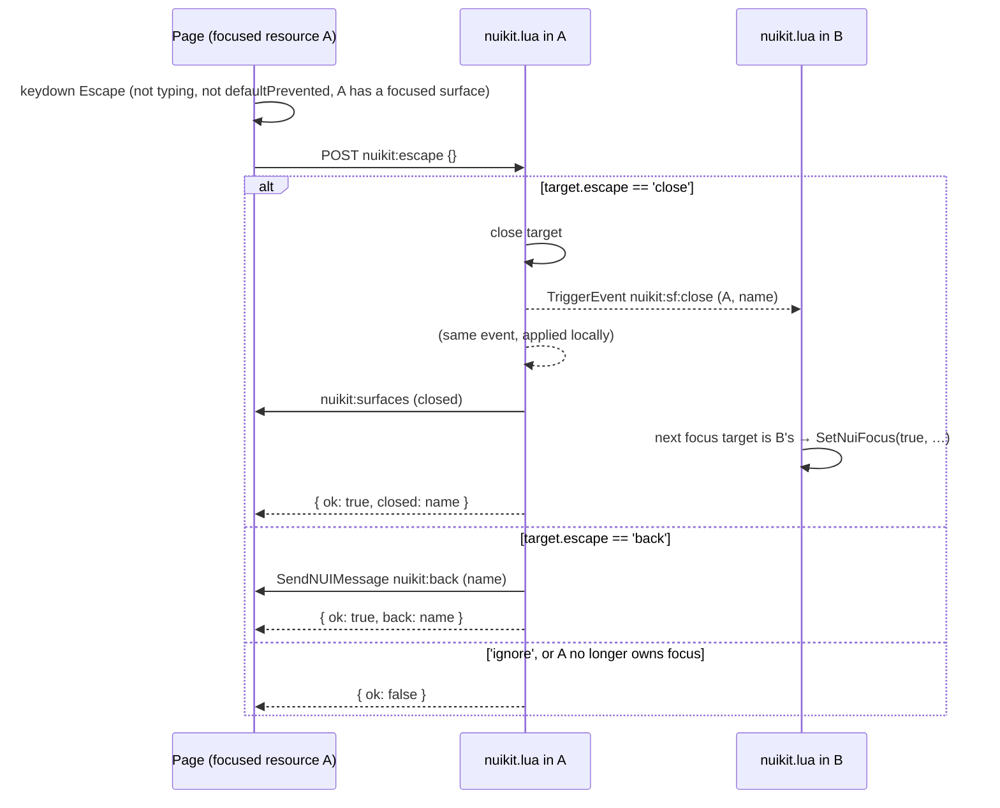
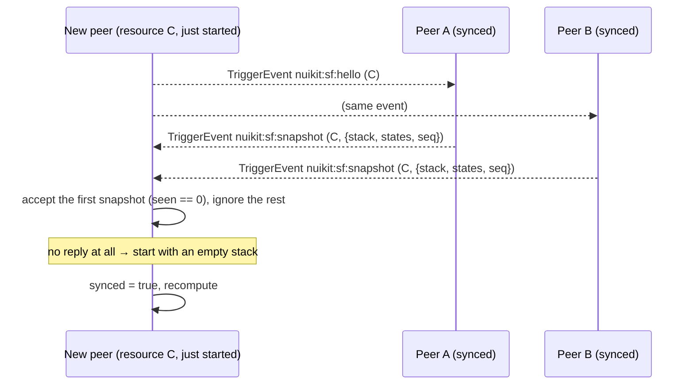
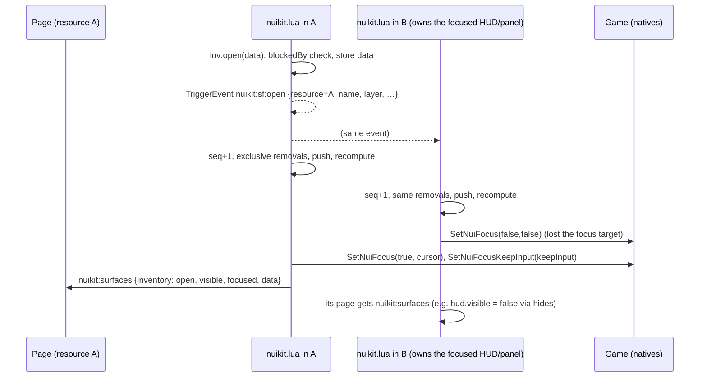

# nuikit protocol v1

*Status: v1, implemented by the reference runtime (`packages/core/lua/nuikit.lua`, `packages/core/lua/bridge.lua`,
`packages/core/src`) on `feat/platform`. Not yet released: ships with the next minor.*

The nuikit protocol is the contract between a FiveM resource's Lua, its NUI page, and every other resource
on the same client, so that a server's UIs share focus, Escape, stacking, theme and player context like apps
on one operating system. It is framework-agnostic: a page written in React, Vue, Svelte or plain JS conforms
if it speaks the messages below. `nuikit-core` (JS) and `nuikit.lua` / `bridge.lua` (Lua) are the reference
implementation.

## 1. Conventions

The key words MUST, MUST NOT, REQUIRED, SHOULD, SHOULD NOT, MAY and OPTIONAL are to be read as in RFC 2119.

| Term | Meaning |
|---|---|
| **Resource** | A FiveM resource. Its name is `GetCurrentResourceName()` in Lua and `GetParentResourceName()` in the page. |
| **Page** | A resource's NUI document (`ui_page`), running in its own CEF frame. |
| **Peer** | One copy of a protocol implementation (in practice, one resource's copy of `nuikit.lua`). Every resource that imports it (`@nuikit/init.lua`) or bundles a copy is a peer; there is no central process: the `nuikit` resource serves the code, each resource runs its own copy. |
| **Surface** | A named piece of UI that a resource declares: a HUD, a panel, a dialog. |
| **Stack** | The client-wide, ordered list of open surfaces, replicated in every peer. |
| **State** | A client-wide named value (`dead`, `cuffed`) that surfaces can be blocked by. |
| **Message** | Lua → page: `SendNUIMessage`. |
| **Callback** | Page → Lua: an HTTP POST to `https://<resource>/<name>`, answered by `RegisterNUICallback`. |
| **Local event** | A client-side `TriggerEvent` / `AddEventHandler` event, delivered to every resource on the client. |

Names that start with `nuikit:` are **reserved** for the protocol in all three namespaces (messages,
callbacks, local events). A resource MUST NOT send, register or trigger a reserved name except as this spec
defines.

## 2. Versioning and capability negotiation

The protocol has one integer version. This document is version `1`. Additive changes (new optional fields,
new capabilities, new messages a peer may ignore) do not bump the version; anything that changes the meaning
of an existing message does.

### 2.1 Declaring the version in fxmanifest

A resource whose page speaks the protocol MUST declare it in `fxmanifest.lua`:

```lua
ui_page 'web/dist/index.html'
nuikit_protocol '1'
```

- The value is the highest protocol version the resource speaks, as a string of decimal digits.
- Tools and peers read it with `GetResourceMetadata(resource, 'nuikit_protocol', 0)`; a missing entry means
  the resource is not a protocol participant (it may still be a nuikit-themed page, see Level 1 in [§10](#10-conformance)).
- An override (a page that replaces another resource's UI and speaks that resource's own wire format, see
  [§5.6](#56-opting-out-the-nuikit-handshake-meta)) MUST NOT declare `nuikit_protocol`, because the Lua it
  runs against is not nuikit's.

Every `systems/*` resource with a `ui_page`, `create-nuikit`'s template and `scripts/new-system.mjs` declare it.

### 2.2 Negotiating in the ready handshake

The page announces the version it speaks in the `nuikit:ready` callback ([§5.5](#55-the-ready-handshake))
and Lua answers with its own:

```jsonc
// page → Lua: POST https://<resource>/nuikit:ready
{ "protocol": 1, "client": "nuikit-core@0.6.0" }
// Lua → page: the callback's response
{ "ok": true, "resource": "my_resource", "protocol": 1, "capabilities": ["surfaces", "states", "theme", "player", "notify"] }
```

- The effective version is the lower of the two. A peer MUST NOT send a message that is newer than the
  effective version.
- A request without `protocol` is from a 0.4.0 page and MUST be treated as version `0`, which is v1 without
  capabilities (every 0.4.0 message keeps its v1 meaning). A response without `protocol` likewise means `0`.
- `capabilities` lists the optional parts Lua provides. v1 defines `surfaces` (§3), `states` (§3.7), `theme`
  (§6), `player` (§7.1, present when `bridge.lua` is loaded), `notify` (§5.4) and `prefs` (§7.3). A page MUST
  treat an absent capability as "not provided" and SHOULD degrade (for example, keep its compiled-in theme).

In the reference implementation: `nuikit-core` sends `{ protocol: 1, client }` and exposes the reply as
`getHandshake()`, `protocolVersion()` and `hasCapability(name)`; `nuikit.lua` answers with `NUI.PROTOCOL` and
lists `theme` only when a server theme exists and `player` only when `bridge.lua` is loaded.

## 3. Surfaces

A surface declares what kind of UI it is; the protocol, not the resource, decides who holds NUI focus,
whether the cursor shows, what is drawn on top, and what Escape does.

### 3.1 Declaration

```lua
local inv = NUI.surface('inventory', {
  layer = 'panel', input = 'full', keepInput = false, exclusive = true,
  escape = 'close', hides = { 'hud' }, blockedBy = { 'dead', 'cuffed' },
})
```

| Option | Type | Default | Meaning |
|---|---|---|---|
| `layer` | `'hud' \| 'world' \| 'panel' \| 'modal' \| 'system'` | `'panel'` | Stacking band. Unknown values MUST be treated as `'panel'`. |
| `input` | `'none' \| 'cursor' \| 'keyboard' \| 'full'` | `'full'` on `panel`/`modal`, else `'none'` | What the surface takes when focused. |
| `keepInput` | boolean | `false` | The player keeps game control while it has focus (`SetNuiFocusKeepInput`). |
| `exclusive` | boolean | `false` | Opening it closes every other open surface on the same layer, from any resource. |
| `escape` | `'close' \| 'back' \| 'ignore'` | `'close'` | What Escape does while it holds focus (§3.5). |
| `hides` | string[] | none | Surface names or layer names hidden while this surface is open and above them. |
| `blockedBy` | string[] | none | States that make `open` refuse. |

A surface name is unique **within** its resource. The same name in two resources is two surfaces. Declaring a
name again replaces its options; it does not change the stack.

### 3.2 Order and focus

The stack is ordered bottom → top by layer rank (`hud` 1, `world` 2, `panel` 3, `modal` 4, `system` 5), then by
open sequence (`seq`, a client-wide counter incremented on every replicated open).

The **focus target** is the top-most open surface whose `input` is not `'none'`. After every change each
peer MUST:

1. If the focus target belongs to its resource: call `SetNuiFocus(true, cursor)` with `cursor = input == 'full'
   or input == 'cursor'`, then `SetNuiFocusKeepInput(keepInput)`.
2. Else, if it set focus earlier: call `SetNuiFocus(false, false)` and `SetNuiFocusKeepInput(false)`.

Only the peer that owns the focus target calls focus natives; nobody else ever does. Because every peer applies
the same replicated changes in the same order, exactly one resource holds focus at a time.

`input = 'keyboard'` gives keyboard focus without a cursor. `input = 'cursor'` is, in v1, an alias of `'full'`
at the native level (FiveM has no "mouse only" focus); a page MUST NOT rely on keystrokes not reaching it. A
later version may give it its own meaning (mouse-only focus via `keepInput` with look controls disabled).

### 3.3 Visibility (`hides`)

An open surface is **hidden** when any surface above it in the stack lists its name or its layer in `hides`.
Hidden surfaces stay open (and keep their place); the page SHOULD stop rendering them. Names in `hides` are
not namespaced: `hides = { 'hud' }` hides the `hud` layer and every surface named `hud` in any resource.

### 3.4 Open, update, close

| Lua | Page (`nuikit-core`) | Effect |
|---|---|---|
| `s:open(data)` | `openSurface(name, data)` → callback `nuikit:surface:open` `{ name, data }` | Refuses (returns `false` / `{ ok: false }`) when a `blockedBy` state is set. If already open: stores `data` and re-sends the view without moving it. Else triggers `nuikit:sf:open`. |
| `s:update(data)` | none | Stores `data`, re-sends the view. No stack change. |
| `s:close()` | `closeSurface(name)` → `nuikit:surface:close` `{ name }` | Triggers `nuikit:sf:close` when open; no-op when closed. |
| `s:toggle(data)`, `s:isOpen()` | none | Convenience. |

`nuikit:surface:open` for a name the resource never declared MUST answer `{ "error": "unknown surface …" }`.

A surface's `data` is local to its resource: it is never replicated, only sent to the owning page.

`blockedBy` gates **opening** only. A state that becomes set while a surface is open does not close it; a
resource that needs that SHOULD watch the state and close the surface itself.

### 3.5 Escape



- The page MUST send `nuikit:escape` (and nothing else) on Escape, only when one of its surfaces is focused,
  and not while the event target is an `input`, `textarea` or content-editable element, or the event was
  `defaultPrevented` (a page MAY use `preventDefault` to let a combobox or nested dialog consume Escape).
- Lua MUST act on the client-wide focus target, and only if it belongs to the resource; one Escape affects
  exactly one surface.
- A page MUST NOT post its own close callback on Escape, and Lua MUST NOT close surfaces on Escape outside
  this flow (that is "ad-hoc Escape", which `nuikit check` reports).
- A page that handles Escape MUST call `preventDefault()`, so a second listener on the same page (simple mode
  and surfaces together) does not send a second `nuikit:escape`.

### 3.6 Replicated events

Changes are local events that every peer, the sender included, applies in delivery order:

| Event | Arguments | Applied by every peer |
|---|---|---|
| `nuikit:sf:open` | `{ resource, name, layer, input, keepInput, exclusive, escape, hides }` | `seq += 1`. If `exclusive`: remove every other entry on `layer`. Remove an existing entry for `(resource, name)`. Push the entry with `seq`. Recompute. |
| `nuikit:sf:close` | `resource, name` | Remove the entry for `(resource, name)` if present. Recompute. |
| `nuikit:sf:state` | `name, value` | `value == false` is stored as `nil`. Recompute. |
| `nuikit:sf:hello` | `resource` | A synced peer that is not `resource` replies with `nuikit:sf:snapshot`. |
| `nuikit:sf:snapshot` | `to, { stack, states, seq }` | Only the peer `to`, only while it has applied no replicated change; see §3.8. |

A peer MUST count every `open`, `close` and `state` event it applies. Entries carry the fields above plus `seq`;
`blockedBy` is not replicated (it is checked by the owner before it triggers `open`).

### 3.7 States

`NUI.state(name, value)` triggers `nuikit:sf:state`; any JSON value is allowed and `false`/`nil` clears it. States
are client-wide and are not owned by the resource that set them: they persist after that resource stops.
`NUI.getState(name)` reads one; pages receive all of them in `nuikit:surfaces`.

### 3.8 Late join



On start a peer MUST trigger `nuikit:sf:hello` with its resource name. It MUST accept the **first** snapshot
addressed to it, and only if it has not yet applied any replicated change (the snapshot would otherwise be older
than its state). If none has arrived when `hello` returns (no other peer, or asynchronous delivery), it MUST
mark itself synced with an empty stack; a snapshot that still arrives before any change is applied replaces it.

### 3.9 Resource stop

On `onClientResourceStop(resource)`:

- The stopping peer MUST release focus if it holds it (`SetNuiFocus(false, false)`,
  `SetNuiFocusKeepInput(false)`). This is the guarantee that a crashed or restarted resource never leaves a
  cursor behind.
- Every other peer MUST remove all entries of `resource` and recompute, so the next focus target takes focus.
- States set by `resource` are kept (see §3.7).

### 3.10 What a page receives: `nuikit:surfaces`

After every recompute a peer sends its page one message describing **its own** surfaces:

```jsonc
{ "action": "nuikit:surfaces", "data": {
  "surfaces": {
    "inventory": { "open": true, "visible": true, "focused": true, "layer": "panel", "data": { /* open(data) */ }, "z": 3 },
    "confirm":   { "open": false, "visible": false, "focused": false, "layer": "modal" }
  },
  "states": { "dead": true }
} }
```

- Every declared surface appears; closed ones have `open: false`.
- `z` is the 1-based position in the client-wide stack (open surfaces only). A page rendering several surfaces
  SHOULD use it for stacking.
- Peers SHOULD suppress the message when it is byte-identical to the last one sent (the reference implementation
  compares JSON encodings) and MUST re-send after `nuikit:ready`.

### 3.11 Simple mode

`NUI.open(opts)` / `NUI.close()` / `NUI.toggle()` are a surface named `main` on the `panel` layer, with
`input` derived from `opts.focus` / `opts.cursor` (`'none'`, `'keyboard'` or `'full'`) and `escape` from
`opts.escape` (default `'close'`). For `main`, Lua also sends `nuikit:visible` (`open and visible`, boolean)
whenever it changes. The page asks to close with the callback `nuikit:close` `{ name? }` (default `main`), for
close buttons; Escape goes through `nuikit:escape` like any surface (§3.5), so the topmost focused surface on the
client gets it even when another resource's modal is above `main`.

## 4. The open flow



## 5. Messaging

### 5.1 Envelope

- Lua → page: `SendNUIMessage({ action = <string>, data = <any> })`. The page receives it as a `message`
  event whose `event.data` is `{ action, data }`. A page MUST ignore messages without a string `action`.
- Page → Lua: `POST https://<resource>/<name>` with `Content-Type: application/json; charset=UTF-8` and a JSON
  body (`{}` when there is no data). Lua registers `<name>` with `RegisterNUICallback` and answers through `cb`.

### 5.2 Naming

Application names SHOULD be `<feature>:<verb or noun>` in lower case (`hud:vitals`, `inventory:use`,
`shop:buy`). `nuikit:` is reserved (§1). A message and a callback MAY share a name.

### 5.3 Responses and errors

- A callback MUST answer exactly once with a JSON object. A handler that returns nothing answers `{}`.
- A failed handler MUST answer `{ "error": "<message>" }` and SHOULD log it on the client console. Pages MUST
  treat any response object with an `error` key as a failure (`nuikit-core` throws `NuiError`).
- A page SHOULD time out a callback (default 10 s) and report it as "callback not registered".
- Responses to built-ins use `ok: boolean` plus the fields listed below.

### 5.4 Built-ins

| Kind | Name | Payload | Response / notes |
|---|---|---|---|
| message | `nuikit:surfaces` | §3.10 | |
| message | `nuikit:visible` | boolean | simple mode only |
| message | `nuikit:back` | surface name (string) | Escape on an `escape = 'back'` surface |
| message | `nuikit:player` | §7.1 | requires `bridge.lua` |
| message | `nuikit:theme` | CSS text (§6) | |
| message | `nuikit:notify` | `{ title, description?, type?: 'default'\|'success'\|'info'\|'warning'\|'error', duration? (ms) }` | a toast |
| callback | `nuikit:ready` | `{ protocol, client }` | `{ ok, resource, protocol, capabilities }` (§2.2) |
| callback | `nuikit:escape` | `{}` | `{ ok, closed? , back? }` |
| callback | `nuikit:close` | `{ name? }` | `{ ok }` |
| callback | `nuikit:surface:open` | `{ name, data? }` | `{ ok }` (`false` when blocked) or `{ error }` |
| callback | `nuikit:surface:close` | `{ name }` | `{ ok }` |

### 5.5 The ready handshake

Messages sent before the page has added its `message` listener are lost, and `ui_page` loads after the
resource's client scripts run. So:

1. The page MUST, once it is listening, call `nuikit:ready` (the reference implementation does it in a
   `setTimeout(…, 0)` after module load).
2. On `nuikit:ready`, Lua MUST forget its de-duplication state and send, in this order: `nuikit:surfaces` (and
   `nuikit:visible` for simple mode), `nuikit:theme` when a server theme exists, `nuikit:prefs`, `nuikit:player`
   when the bridge is loaded. Then it answers per §2.2.
3. The page MAY call `nuikit:ready` again (after a reload); Lua MUST answer the same way each time.

### 5.6 Opting out: the `nuikit-handshake` meta

A page whose Lua is not nuikit's (an override built into another resource's UI folder) MUST include

```html
<meta name="nuikit-handshake" content="off">
```

and a runtime MUST then send no `nuikit:*` callback. Such a page receives the theme by fetching
`https://cfx-nui-nuikit/theme.css` (with `nui://nuikit/theme.css` as a fallback) and speaks the overridden
resource's own wire format, documented in `docs/<name>-protocol.md`.

## 6. Theme

The token names, types and defaults are **tokens v1**, defined in [`docs/tokens.md`](tokens.md) (and as a W3C
DTCG file under `packages/core/tokens/`). In short: the shadcn base tokens (`background`, `foreground`, `card`,
`popover`, `primary`, `secondary`, `muted`, `accent`, `destructive`, each with `-foreground` where shadcn has one;
`border`, `input`, `ring`, `chart-1`…`chart-5`, `radius`, `font-sans`, `font-mono`, the `sidebar-*` set), plus
nuikit's `success`, `warning`, `info` (each with `-foreground`), `hud`, `hud-foreground`, `vital-health`,
`vital-armor`, `vital-hunger`, `vital-thirst`, `vital-stress`, `nk-scale` and `nk-motion`. `nuikit tokens`
prints the list.

- A conforming page MUST take every colour a token covers from the token's CSS custom property
  (`var(--primary)`, or a utility that resolves to it such as Tailwind's `bg-primary`). Fixed colours are allowed
  only for what a theme cannot know (GTA palettes, item images); mark them with a `nuikit-ignore` comment so
  `nuikit check` can tell them apart.
- **Source.** The server theme is `theme.css` in the resource named `nuikit` (any TweakCN / shadcn paste or a
  DTCG token file), and nothing else is a server-wide theme.
- **Compiled once.** The `nuikit` resource compiles it at start and on `nuikit theme reload` (`compileTheme`:
  oklch lowered to `rgb()`/`rgba()`, missing tokens derived, dark set chosen, contrast checked, warnings in the
  server console) and publishes the result as `GlobalState.nuikitTheme`:
  `{ version: 1, mode, hash, vars: { [token]: value }, imports: string[] }` (see [`docs/tokens.md`](tokens.md#distribution)).
- **`nuikit:theme`.** Lua sends the compiled theme on `nuikit:ready` and again whenever the state bag
  changes (live reload). The page applies `vars` (and each token's `-rgb` / `-a` channels) to
  `document.documentElement` and loads `imports` (fonts) once each. For compatibility the payload MAY instead
  be CSS text (`:root` / `.dark` blocks), from an older `nuikit` resource; a page MUST accept both and compile
  the text itself.
- **Pages that can't receive messages** (handshake-off overrides, §5.6, and the chat theme) call the NUI
  callback `https://nuikit/theme`, then keep a request open that answers when the theme or the player's prefs
  change (or "unchanged" after 25 s). If that callback doesn't answer they fetch `theme.css` and compile it.
  The loading screen receives the compiled theme in the connection handover
  (`deferrals.handover({ nuikit = { theme = … } })`).
- A page MUST render correctly with its compiled-in defaults when no theme arrives.

## 7. Context

### 7.1 Player (`nuikit:player`)

`bridge.lua` adapts the framework to one shape and sends it when it changes (JSON-equality de-dup, values polled
every 250 ms, plus framework events):

```ts
interface NuiPlayer {
  loaded: boolean;            // a character is loaded
  id?: string;                // citizenid (Qbox/QBCore) or identifier (ESX)
  name?: string;
  health: number;             // 0–100
  armor: number;              // 0–100
  hunger?: number;            // 0–100, when the framework tracks it
  thirst?: number;
  stress?: number;
  cash?: number;
  bank?: number;
  job?: { name: string; label?: string; grade: number; gradeLabel?: string; onDuty?: boolean };
  gang?: { name: string; label?: string; grade: number; gradeLabel?: string };
  dead: boolean;              // dead, or downed/last stand per the framework
  voice: { range?: number; mode?: string; talking: boolean; radio?: number };
}
```

- Frameworks: `qbox` (`qbx_core`), `qbcore` (`qb-core`), `esx` (`es_extended`), `standalone`, detected in that
  order from started resources, overridden by the `nuikit_framework` convar. Lua exposes `NUI.player.framework`,
  `get()`, `set(fields)`, `onChange(fn)`, `resend()`.
- Fields a framework does not provide MUST be omitted, not zeroed (`hunger` on standalone is absent).
- Pages SHOULD merge onto defaults `{ loaded: false, health: 100, armor: 0, dead: false, voice: { talking: false } }`.
- The bridge also keeps a `downed` field internally to compute `dead`; it is not part of the contract and is
  never sent (`NUI.player.get()` leaves it out too).

### 7.2 Locale

Not in v1. Pages SHOULD use the game's language (`GetCurrentLanguage`) via their own Lua until a `locale`
capability is added.

### 7.3 Preferences (`nuikit:prefs`, capability `prefs`)

Per-player accessibility preferences, never a different theme:

```jsonc
{ "action": "nuikit:prefs", "data": { "scale": 1, "reducedMotion": false, "highContrast": false } }
```

- `scale` (0.85–1.25, default `1`) multiplies the theme's `--nk-scale`. `reducedMotion` sets `--nk-motion: 0`
  and `data-nk-motion="off"` on `<html>`; pages MUST then drop non-essential animation. `highContrast` applies
  the compiler's high-contrast adjustments and sets `data-nk-contrast="high"`.
- Stored per player in the `nuikit` resource's client KVP (or the UI resource's own KVP without it). Lua sends
  them after `nuikit:theme` on ready and to every UI whenever they change.
- Set with `NUI.prefs.set(patch)`, `exports.nuikit:setPrefs(patch)` or `/nuikit scale|motion|contrast|reset`;
  read with `NUI.prefs.get()`. Details in [`docs/tokens.md`](tokens.md#player-preferences).

## 8. Lua API summary (reference implementation)

Resources import it with `dependency 'nuikit'` and `shared_script '@nuikit/init.lua'`, which loads it from the
running `nuikit` resource (`nk` and `NUI` are the same table; the framework bridge loads on first use of
`nk.player`). A copy of `lib/nuikit.lua` as a client script also works, without the nuikit resource.

`NUI.send(action, data)` · `NUI.on(name, handler)` (pcall, `{ error }` on failure) · `NUI.notify(n)` ·
`NUI.surface(name, opts)` → `:open(data)` `:close()` `:update(data)` `:toggle(data)` `:isOpen()` ·
`NUI.state(name, value)` · `NUI.getState(name)` · `NUI.surfaces()` (stack, bottom → top) · `NUI.open(opts)`
`NUI.close()` `NUI.toggle(opts)` `NUI.isOpen()` · `NUI.theme()` · `NUI.prefs.get()` `NUI.prefs.set(patch)` ·
`NUI.player.*` (§7.1) · `NUI.PROTOCOL`. Debug logging: convar `nuikit_debug 1`.

## 9. Security

The page and the Lua of one resource trust each other; peers trust each other's local events (any client
script can trigger them, as with any FiveM local event). A peer MUST NOT act on a `nuikit:surface:*`
callback for a surface its own resource did not declare, and MUST NOT accept callbacks on behalf of another
resource.

## 10. Conformance

Three cumulative levels. `nuikit check <resource>` reports the highest one a resource reaches and every
finding that keeps it from the next.

### Level 1: themed

- MUST read the theme tokens (§6): at least one token reference (`var(--primary)`, `bg-primary`, a kit
  `nk-*` utility).
- MUST NOT hard-code a colour a token covers: no hex, `rgb()`, `hsl()`, `oklch()`/`oklab()`/`lab()`/`lch()`/
  `hwb()` literals and no Tailwind palette classes (`bg-emerald-500`) in styles or markup. Token *definitions*
  (custom properties named after tokens in `:root`, `.dark`, `@theme`) and black/white shadows are allowed;
  anything else needs `nuikit-ignore` with a reason.

### Level 2: well-behaved

Level 1, and:

- MUST declare `nuikit_protocol` in fxmanifest when it has a `ui_page` (§2.1).
- MUST register its UI as surfaces (`NUI.surface` or simple mode) rather than managing visibility alone.
- MUST NOT call `SetNuiFocus` / `SetNuiFocusKeepInput` itself (only the protocol implementation does, §3.2).
- MUST release focus when it stops (§3.9): automatic with `nuikit.lua`; otherwise an `onClientResourceStop`
  handler that calls `SetNuiFocus(false, false)`.
- MUST handle Escape through surfaces (§3.5), not with its own keydown listener that posts a close callback.

### Level 3: native

Level 2, and:

- MUST use the nuikit runtime: `nuikit.lua` loaded as a client script and `nuikit-core` (or a conforming
  binding) in the page.
- MUST build on the kit's components (stock shadcn/ui and the nuikit registry), following `docs/design.md`.

### Performance advisories (all levels)

Not level-gating, but reported: remote fonts and assets (every UI pays a network fetch and a separate font load;
ship them in the resource), and NUI messages sent from a `Wait(0)` loop (send on change, or batch, at ≤ 10 Hz).

Overrides (§5.6) are measured on the rules that apply to a page whose Lua is not nuikit's: Level 1 and the
page-side Level 3 rules (`nuikit-core`, components). Their Escape handling is dictated by the overridden
resource's protocol, so ad-hoc Escape is reported as advisory for them, not as a Level 2 failure. A resource
with styles but no page of its own (a chat theme, the `nuikit` theme resource) is graded on Level 1 only.

Exceptions are marked in source with `nuikit-ignore [rule …]` (same line, or alone on the line above) or
`nuikit-ignore-next-line [rule …]`, or around a block with `nuikit-ignore-start [rule …]` … `nuikit-ignore-end`, with a reason.

## 11. Changes needed in the runtime

None: every change this spec asked of 0.4.0 shipped on `feat/platform` (versioned manifests, the versioned
handshake with capabilities, compiled themes with live reload, player prefs, `downed` kept internal, one Escape
path for simple mode, `input = 'cursor'` documented as an alias). Open questions for v2: `locale` (§7.2) and a
real mouse-only `input = 'cursor'`.
